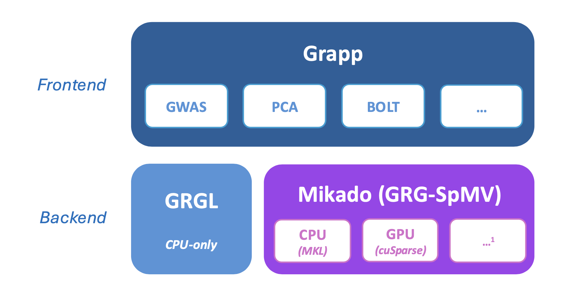
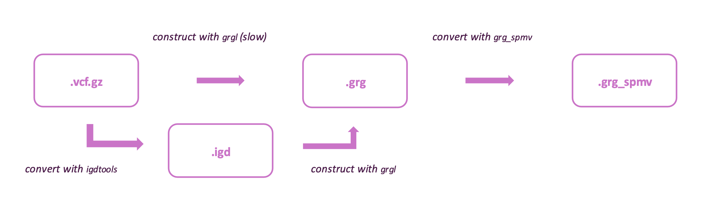

<p align="center">
  
</p>

# Mikado

Mikado is a sparse-linear-algebra powered backend for Genotype Representation Graph (GRG) computation. It is designed to be efficient, scalable, and portable, all at Biobank scale. It supports x86 CPUs, NVIDIA GPUs and resident single-device AMD GPUs.

Mikado can achieve speedups of hundreds or even thousands times compared to conventional implementations (PLINK2, BOLT-LMM, etc.), reducing runtime and cost at the same time. Mikado is able to compute **PCA** on the **full All of Us** v8 phased dataset (414,830 Individuals; 870,337,413 Mutations) within **180 seconds**, and **BOLT-LMM-inf** on the 1000 Genomes dataset within **60 seconds**. Compared to the GRGL (GRG Library) implementation, Mikado with A100 GPU can accelerate a single traversal by up to 470x.

For further details on the SpMV-based formulation and performance, please check our preprint, *Sparse Linear Algebra Accelerates Genotype Representation Graph Computation at Biobank Scale* ([link](https://www.biorxiv.org/content/10.64898/2026.09.10.750583v1.full.pdf)). To reproduce the results in the preprint, please refer to the `preprint` branch.

## Table of Contents

- [Citation](#citation)
- [Workflow](#workflow)
- [Resource Requirement](#resource-requirement)
  - [GRG Construction Time](#grg-construction-time)
  - [GRG_SPMV Conversion Time](#grg_spmv-conversion-time)
  - [RAM Requirement for Mikado (GRG-SpMV)](#ram-requirement-for-mikado-grg-spmv)
- [Installation and Usage](#installation-and-usage)
- [Acknowledgements](#acknowledgements)

## Citation

If you use Mikado in your work, please cite:

```bibtex
@article{mikado,
  author       = {Li, Yifan and Sun, Qingyao and DeHaas, Drew and Zhao, Max Xiaohang and Boyko, Adam R. and Musharoff, Shaila A. and Wei, Xinzhu and Guidi, Giulia},
  title        = {Sparse Linear Algebra Accelerates Genotype Representation Graph Computation at Biobank Scale},
  year         = {2026},
  journal      = {bioRxiv},
  publisher    = {Cold Spring Harbor Laboratory},
  doi          = {10.64898/2026.09.10.750583},
  url          = {https://www.biorxiv.org/content/10.64898/2026.09.10.750583v1},
  note         = {Preprint}
}
```

## Workflow

Mikado is based on GRG (Genotype Representation Graph), a novel graph-based representation for genotype data that enables efficient storage and computation on genetic variants at Biobank scale. Please refer to the [grg docs](https://grgl.readthedocs.io/en/stable/) and the [research paper](https://www.nature.com/articles/s43588-024-00739-9) for more information on GRG.

Our work, Mikado, does not change the graph representation. Instead, we introduced a SpTRSV-SpMV formulation, with pipelined wavefront block forward substitution, as a compute method on top of GRG. With this formulation, the computation is lowered to SpMV primitives, which is commonly-provided and highly-optimized on different hardware.

<p align="center">
  
</p>

**Originally**, GRG-based application is disaggregated into two parts: 
- [GRGL](https://github.com/aprilweilab/grgl), which is responsible for GRG consturction and manipulation, and serves as the **Backend** for GRG-based computation.
- [Grapp](https://github.com/aprilweilab/grapp), which is the **Frontend** and includes the implementations for GRG-based applications, such as GWAS, PCA, and BOLT-LMM-inf. 

The main code repository for **Mikado**, [GRG-SpMV](https://github.com/CornellHPC/GRG-SpMV), **serves as an alternative computation backend for Grapp.** It uses Intel MKL on CPUs, cuSPARSE on NVIDIA GPUs and rocSPARSE on AMD GPUs. The sparse formulation and application interfaces are shared.


<p align="center">
  
</p>

The figure above shows the file formats used. The `.grg` files can be constructed from `.vcf.gz` files. Using `igd` as an intermediate format can speedup the construction in most cases. Construction of GRGs generally take multiple hours for a single chromosome on Biobank-scale datasets.
Mikado (GRG-SpMV backend) currently requires a dedicated format, `.grg_spmv`. The conversion from `.grg` to `.grg_spmv` is expected to be lightweight.

## Resource Requirement

### GRG Construction Time

The construction of GRG is a resource-intensive process, but the hardware requirement and time consumption generally stays within reasonable range. Here we show the construction time of GRGs on selected chromosome of the All of Us v8 Phased dataset (with 414,830 individuals). The `n1_regular_32` instance type, with 16 physical cores and 120GB of RAM is used for construction.

|Chromosome|`.vcf.gz` File Size|Number of Variants|IGD Conversion Time|GRG Construction Time|
|----------|-------------------|------------------|--------------------|---------------------|
|chr5     | 196 GB            | 57,032,792       | 11.9 hours         | 2.9 hours             |
|chr13     | 108 GB            | 30,469,204       | 5.9 hours          | 1.4 hours           |
|chr22     | 42 GB            | 11,973,519       | 2.24 hours         | 0.8 hours           |

### GRG_SPMV Conversion Time

The conversion from `.grg` files to `.grg_spmv` files is expected to be lightweight. Since only one thread is needed for converting a chromosome, the conversion of multiple chromosomes can happen concurrently on a machine. The conversion of all chromosomes in All of Us v8 phased should finish within 12 hours on the `n1_regular_32` instance type.

### RAM Requirement for Mikado (GRG-SpMV)

RAM consumption is the major constraint of the Mikado approach, especially on GPU where VRAM is limited. On CUDA, "streaming mode", where chromosomes not currently used reside in CPU memory, can alleviate some memory pressure, but introduces additional overhead and is not recommended in general.
Alternatively, if multiple NVIDIA GPUs are available on a single node, the workload can be distributed across them to mitigate memory constraints. NVLINK connection between GPUs are highly recommended in this case.

While RAM usage behavior depends on the specific dataset and application, we conclude that GRGs are the components that consume the most memory (>80%) in the pipeline.
Extended Section 4 of [our preprint](https://www.biorxiv.org/content/biorxiv/early/2026/09/12/2026.09.10.750583.full.pdf) provides details and examples on memory consumption patterns. Here we show the file size of selected chromosomes in the All of Us v8 phased dataset.

|Chromosome|`.vcf.gz` File Size|`.grg` File Size|`.grg_spmv` File Size|
|----------|---------|------------------|------------------|
|chr5     | 196 GB  | 6.4 GB       | 12GB       |
|chr13    | 108 GB  | 3.7 GB       | 6.8GB       |
|chr22    | 42 GB   | 1.9 GB       | 3.5GB       |

In our experiments, 4*A100(80 GB) is enough for all experiments performed on the All of Us v8 phased dataset, whose `.grg_spmv` file sizes total to 197GB. 

## Installation and Usage

Install [GRGL](https://github.com/aprilweilab/grgl), the
[CornellHPC grapp fork](https://github.com/CornellHPC/grapp/tree/rocm-support)
and [GRG-SpMV](https://github.com/CornellHPC/GRG-SpMV/tree/rocm-support).
Use the linked `rocm-support` revisions for this backend update. Follow the
[core installation instructions](https://github.com/CornellHPC/GRG-SpMV/tree/rocm-support#install)
for your hardware and the [Python API examples](https://github.com/CornellHPC/GRG-SpMV/tree/rocm-support#basic-usage)
for conversion and PCA, GWAS or BOLT-LMM-inf. CUDA supports resident, streaming
and multi-GPU execution; ROCm supports resident execution on one device.

The [v0.2 release](https://github.com/CornellHPC/Mikado/releases/tag/v0.2)
provides the original preprint reproduction artifacts.

For changes to the Mikado integration, follow the shared [contribution guide](https://github.com/CornellHPC/GRG-SpMV/blob/rocm-support/CONTRIBUTING.md).

## Acknowledgements

The authors gratefully acknowledge *All of Us* participants for their contributions, without whom this research would not have been possible. We thank Andrew Clark and Can Firtina for their feedback on the manuscript. In addition, we thank the National Institutes of Health *All of Us* Research Program for making available the participant data examined in this study. This study used data from the *All of Us* Research Program Controlled Tier Dataset CDRv8, available to authorized users on the Researcher Workbench.

This material is based upon work supported by the National Science Foundation under Grant IIS-2435801. This research used resources from the National Energy Research Scientific Computing Center, a DOE Office of Science User Facility supported by the Office of Science of the U.S. Department of Energy under Contract No. DE-AC02-05CH11231, using NERSC award ASCR-ERCAP0030076. This work used DeltaAI at the National Center for Supercomputing Applications (NCSA) through allocation CIS251351 from the Advanced Cyberinfrastructure Coordination Ecosystem: Services & Support (ACCESS) program, which is supported by U.S. National Science Foundation grants #2138259, #2138286, #2138307, #2137603, and #2138296.
